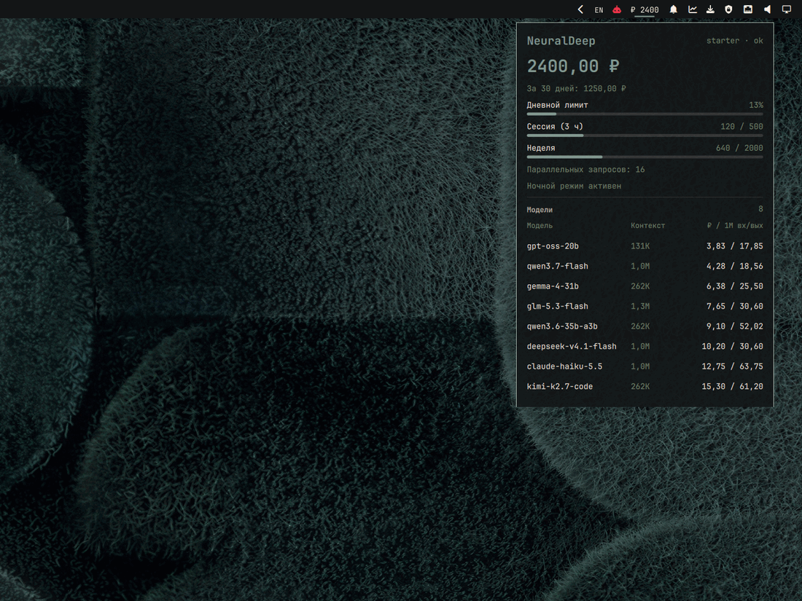

# Omarchy NeuralDeep

**English** · [Русский](README.ru.md)

NeuralDeep balance and usage in your Omarchy bar. Click the balance, and a compact popup shows your wallet, spend, daily capacity, and the context window and price of every chat model your key can use — without opening the NeuralDeep dashboard.

- **Balance on the bar.** A `₽ 2400`-style wallet balance, refreshed in the background.
- **Usage meters.** Daily capacity, session and week quotas when the plan reports them, the parallel limit, and the night window.
- **Model pricing.** Every chat model the key can see, with context size and ₽ per 1M input/output tokens, cheapest first.
- **One key, three sources.** `NEURALDEEP_API_KEY`, `~/.config/neuraldeep/api-key`, or an existing opencode provider config.
- **Local by default.** No telemetry, no writes, no remote commands. Two GET requests to NeuralDeep, and the key goes nowhere else.
- **Native install.** One `omarchy plugin add` command; no build step, no extra service.



*Preview with sample data.*

## Contents

- [About NeuralDeep](#about-neuraldeep)
- [Install](#install)
- [Configure the key](#configure-the-key)
- [Usage](#usage)
- [Security](#security)
- [Development](#development)
- [License](#license)

## About NeuralDeep

[NeuralDeep](https://neuraldeep.ru) is an OpenAI-compatible LLM gateway and API platform. One `sk-` key and the base URL `https://api.neuraldeep.ru/v1` work with the OpenAI SDK, opencode, Cursor, Cline, Continue, LangChain, and any other OpenAI client.

- **Models.** Qwen-family chat models, GPT-OSS, Gemma, Kimi, Claude, DeepSeek, GLM, MiniMax, embeddings, rerank, Whisper transcription, TTS, OCR, image and music generation, and web/Telegram search.
- **Where it runs.** The main Qwen, embedding, rerank, and Whisper models run on NeuralDeep's own GPUs in Russia; other catalog models go through external vendors, with the processing region marked per model.
- **Payment.** Rubles, no VPN or foreign card. Either a monthly subscription (Free, Starter, Pro, Coder, Qwen ∞) or a pay-as-you-go wallet. The free tier includes the open models.
- **Docs.** [Models](https://neuraldeep.ru/models), [pricing](https://neuraldeep.ru/pricing), [API docs](https://neuraldeep.ru/docs), [limits API](https://neuraldeep.ru/docs/limits-api.md), [dashboard](https://neuraldeep.ru/app).

This widget reads the public `GET /v1/limits` and `GET /v1/models` endpoints. It is an unofficial community plugin and is not affiliated with NeuralDeep; the service and its name belong to their owners.

## Install

Requirements: Omarchy with the Quattro shell, plus `curl` and `jq` (both ship with Omarchy).

```sh
omarchy plugin add https://github.com/CryptoMiron/omarchy-neuraldeep.git --enable
```

The command clones the repository into `~/.config/omarchy/plugins/miron.neuraldeep`, validates the manifest, and asks where to put the widget on the bar. Choose `right` or any other section.

Non-interactive install:

```sh
omarchy plugin add https://github.com/CryptoMiron/omarchy-neuraldeep.git --yes
omarchy plugin enable miron.neuraldeep --section right
```

To inspect the code before enabling it, install without `--enable`, read the plugin folder, then enable it:

```sh
omarchy plugin add https://github.com/CryptoMiron/omarchy-neuraldeep.git --yes
less ~/.config/omarchy/plugins/miron.neuraldeep/Widget.qml
omarchy plugin enable miron.neuraldeep --section right
```

## Configure the key

Create a key file readable only by you:

```sh
mkdir -p ~/.config/neuraldeep
printf '%s\n' 'sk-your-neuraldeep-key' > ~/.config/neuraldeep/api-key
chmod 600 ~/.config/neuraldeep/api-key
```

The widget reads the first line on every refresh. Open the popup once, or wait for the next automatic refresh.

Other supported sources, in order:

1. `NEURALDEEP_API_KEY` in the environment that starts the Omarchy shell.
2. `~/.config/neuraldeep/api-key` (or the path in `NEURALDEEP_KEY_FILE`).
3. `providers.neuraldeep.settings.apiKey` in `~/.config/opencode/opencode.json`, if you already use NeuralDeep in opencode.

## Usage

- **Left click** the balance to open or close the popup.
- **Middle click** to refresh immediately.
- **Refresh interval** is the `refreshSec` setting in the widget's `shell.json` entry: 30–3600 seconds, default 300.
- **Remove** with `omarchy plugin remove miron.neuraldeep`, then delete `~/.config/neuraldeep/api-key` if you created it.

## Security

- The key is sent only to `https://api.neuraldeep.ru/v1` (or to `NEURALDEEP_BASE_URL` if you set it), in an `Authorization: Bearer` header.
- The header is piped to `curl` on stdin, so the key does not appear in `ps`.
- No telemetry, no file writes, no remote code, and no shell commands built from API data.
- Like every Omarchy plugin, it runs unsandboxed inside the shell. The network and parsing code is one POSIX shell script: [`bin/neuraldeep`](bin/neuraldeep). The UI is [`Widget.qml`](Widget.qml).

## Development

```sh
sh test/neuraldeep-test.sh
omarchy plugin validate .
```

The test stubs `curl` and runs offline.

```
manifest.json
Widget.qml
bin/neuraldeep
i18n/en.json
i18n/ru.json
test/neuraldeep-test.sh
preview.png
preview-ru.png
README.md
README.ru.md
LICENSE
```

## License

MIT. See [LICENSE](LICENSE).