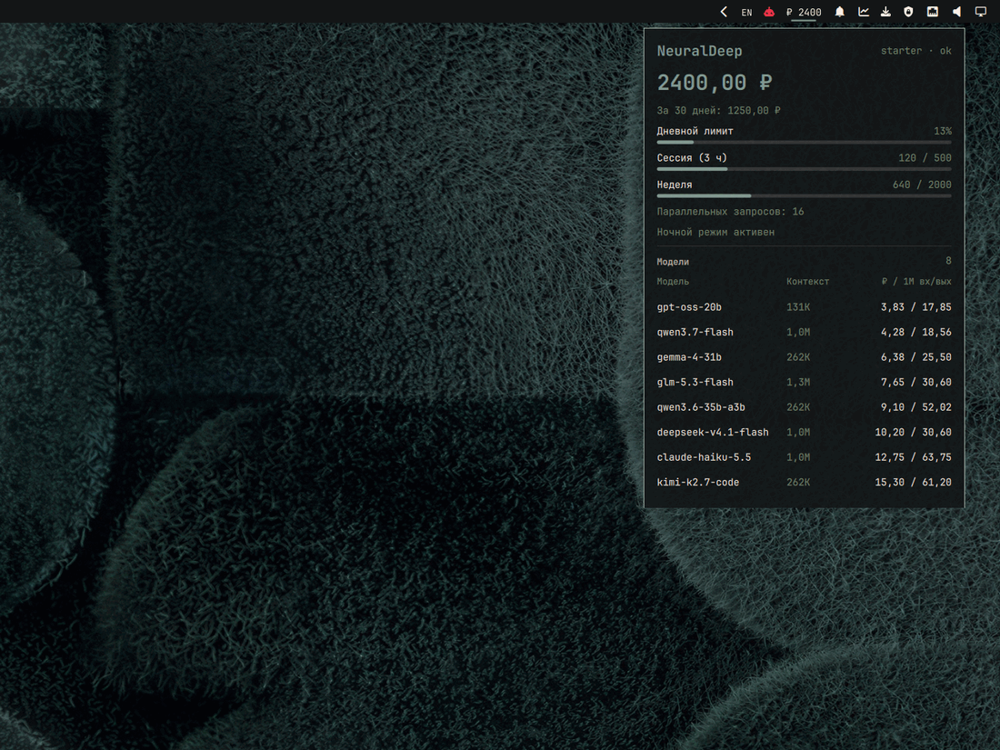

# Omarchy NeuralDeep

[English](README.md) · **Русский**

Баланс и расход NeuralDeep в баре Omarchy. Нажмите на баланс — откроется компактная панель с кошельком, расходом, дневным лимитом, а также контекстом и ценой каждой чат-модели, доступной вашему ключу. Без похода в личный кабинет NeuralDeep.

- **Баланс в баре.** Баланс кошелька в формате `₽ 2400`, обновляется в фоне.
- **Лимиты и расход.** Дневная ёмкость, квоты сессии и недели (если тариф их отдаёт), лимит параллельных запросов и ночной режим.
- **Цены моделей.** Все чат-модели, доступные ключу: контекст и цена за 1 млн входных и выходных токенов в рублях, сначала дешёвые.
- **Один ключ, три источника.** `NEURALDEEP_API_KEY`, `~/.config/neuraldeep/api-key` или конфиг провайдера в opencode.
- **Только локально.** Без телеметрии, записи на диск и удалённых команд. Два GET-запроса к NeuralDeep — и ключ больше никуда не уходит.
- **Нативная установка.** Одна команда `omarchy plugin add`, без сборки и отдельных сервисов.



*Превью на демо-данных.*

## Содержание

- [О NeuralDeep](#о-neuraldeep)
- [Установка](#установка)
- [Настройка ключа](#настройка-ключа)
- [Использование](#использование)
- [Безопасность](#безопасность)
- [Разработка](#разработка)
- [Лицензия](#лицензия)

## О NeuralDeep

[NeuralDeep](https://neuraldeep.ru) — OpenAI-совместимый LLM-шлюз и API-платформа. Один ключ `sk-` и base URL `https://api.neuraldeep.ru/v1` работают с OpenAI SDK, opencode, Cursor, Cline, Continue, LangChain и любым другим OpenAI-клиентом.

- **Модели.** Чат-модели семейства Qwen, GPT-OSS, Gemma, Kimi, Claude, DeepSeek, GLM, MiniMax, эмбеддинги, реранк, транскрибация Whisper, TTS, OCR, генерация картинок и музыки, веб-поиск и поиск по Telegram.
- **Где работает.** Основные модели Qwen, эмбеддинги, реранк и Whisper — на собственных GPU NeuralDeep в РФ; остальной каталог идёт через внешних вендоров, регион обработки указан у каждой модели.
- **Оплата.** В рублях, без VPN и зарубежных карт. Либо месячная подписка (Free, Starter, Pro, Coder, Qwen ∞), либо кошелёк с оплатой по токенам. На бесплатном тарифе доступны открытые модели.
- **Документация.** [Модели](https://neuraldeep.ru/models), [тарифы](https://neuraldeep.ru/pricing), [API](https://neuraldeep.ru/docs), [Limits API](https://neuraldeep.ru/docs/limits-api.md), [кабинет](https://neuraldeep.ru/app).

Виджет читает публичные эндпоинты `GET /v1/limits` и `GET /v1/models`. Это неофициальный community-плагин, не связанный с NeuralDeep; сервис и его название принадлежат владельцам.

## Установка

Нужны Omarchy с оболочкой Quattro, а также `curl` и `jq` — оба уже есть в Omarchy.

```sh
omarchy plugin add https://github.com/CryptoMiron/omarchy-neuraldeep.git --enable
```

Команда клонирует репозиторий в `~/.config/omarchy/plugins/miron.neuraldeep`, проверит манифест и спросит, в какую секцию бара поставить виджет. Выберите `right` или любую другую.

Неинтерактивная установка:

```sh
omarchy plugin add https://github.com/CryptoMiron/omarchy-neuraldeep.git --yes
omarchy plugin enable miron.neuraldeep --section right
```

Чтобы сначала прочитать код, установите без `--enable`, откройте папку плагина, затем включите:

```sh
omarchy plugin add https://github.com/CryptoMiron/omarchy-neuraldeep.git --yes
less ~/.config/omarchy/plugins/miron.neuraldeep/Widget.qml
omarchy plugin enable miron.neuraldeep --section right
```

## Настройка ключа

Создайте файл ключа, доступный только вам:

```sh
mkdir -p ~/.config/neuraldeep
printf '%s\n' 'sk-your-neuraldeep-key' > ~/.config/neuraldeep/api-key
chmod 600 ~/.config/neuraldeep/api-key
```

Виджет читает первую строку при каждом обновлении. Откройте панель один раз или дождитесь следующего автообновления.

Другие источники, по порядку:

1. `NEURALDEEP_API_KEY` в окружении, из которого запускается оболочка Omarchy.
2. `~/.config/neuraldeep/api-key` (или путь из `NEURALDEEP_KEY_FILE`).
3. `providers.neuraldeep.settings.apiKey` в `~/.config/opencode/opencode.json`, если NeuralDeep уже настроен в opencode.

## Использование

- **Левый клик** по балансу открывает и закрывает панель.
- **Средний клик** обновляет сразу.
- **Интервал обновления** — настройка `refreshSec` в записи виджета в `shell.json`: от 30 до 3600 секунд, по умолчанию 300.
- **Удаление** — `omarchy plugin remove miron.neuraldeep`, затем удалите `~/.config/neuraldeep/api-key`, если создавали его.

## Безопасность

- Ключ уходит только на `https://api.neuraldeep.ru/v1` (или на `NEURALDEEP_BASE_URL`, если вы его задали), в заголовке `Authorization: Bearer`.
- Заголовок передаётся `curl` через stdin, поэтому ключ не виден в `ps`.
- Нет телеметрии, записи на диск, удалённого кода и shell-команд, собранных из данных API.
- Как и любой плагин Omarchy, виджет работает без песочницы внутри оболочки. Весь сетевой код и разбор — один POSIX-скрипт: [`bin/neuraldeep`](bin/neuraldeep). Интерфейс — [`Widget.qml`](Widget.qml).

## Разработка

```sh
sh test/neuraldeep-test.sh
omarchy plugin validate .
```

Тест подменяет `curl` и работает офлайн.

```
manifest.json
Widget.qml
bin/neuraldeep
i18n/en.json
i18n/ru.json
test/neuraldeep-test.sh
preview.png
preview-ru.png
README.md
README.ru.md
LICENSE
```

## Лицензия

MIT. См. [LICENSE](LICENSE).